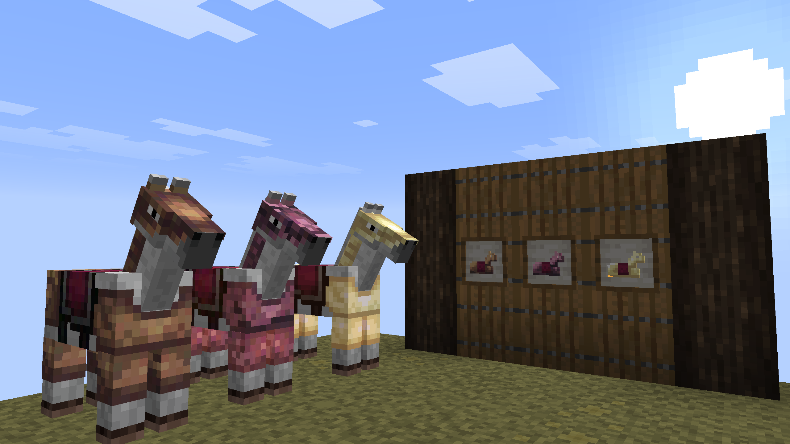

# Matcha Horse Armor Add-on

This datapack is an add-on / proof of concept based on [this issue](https://github.com/kleiwright/matcha-flavoured/issues/560). It adds Hepatizon, Shakudo, and Electrum horse armor based on Klei's [Matcha Flavoured](https://modrinth.com/datapack/matcha-flavoured) datapack. This datapack will not work without Matcha Flavoured.

Electrum assests comes from Klei Wright. I only change the colors for the Hepatizon and Shakudo assets. Please [support Klei](https://ko-fi.com/kleiwright) if you enjoy their work.

## Features

### Hepatizon horse armor

Smith a copper horse armor with a Hepatizon alloy.

The Hepatizon armor gives a 30% speed boost to the horse wearing it. 

### Shakudo horse armor

Smith a copper horse armor with a Shakudo alloy.

The Shakudo armor regenerates half a heart every 30sec for the rider. 

### Electrum horse armor

Smith a diamond horse armor with an Electrum alloy.

The Electrum armor gives the Warding 4 effect to the horse wearing it. 

## Compatibility

The alloyed armors are compatible with [Icy's Better Horses](https://modrinth.com/mod/icys-better-horses) mod. 
Note that the textures are not compatible with it due to some limitations.

